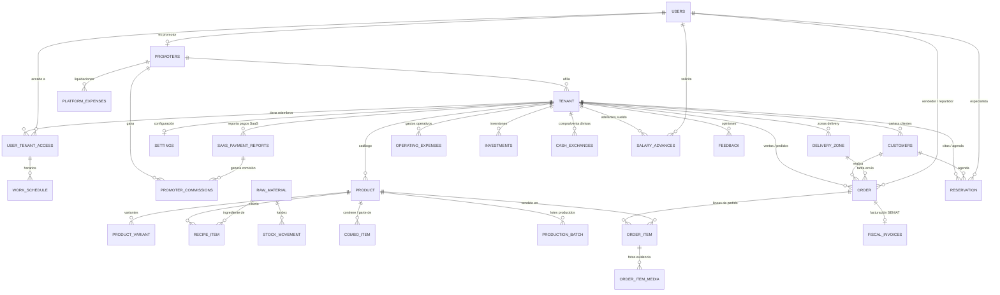

# 🗄️ Esquema Oficial de Base de Datos — FinoWork (PostgreSQL + TypeORM)

> **Propósito del Documento:** Este archivo sirve como referencia técnica completa y desglosada del modelo de datos de **FinoWork** para desarrolladores de backend, frontend, DBAs y agentes de inteligencia artificial.
> **Motor:** PostgreSQL 14+ (Compatible con Supabase, Neon, Render, AWS RDS)
> **ORM:** TypeORM (`apps/backend/src/entities/*.entity.ts`)
> **Transformador Numérico:** Todas las columnas `decimal` / `numeric` utilizan `ColumnNumericTransformer` (`apps/backend/src/common/transformers/column-numeric.transformer.ts`), el cual convierte automáticamente los strings de PostgreSQL en `number` de JavaScript (`parseFloat(data)`) al leer desde la base de datos.

---

## 🗺️ Diagrama Entidad-Relación (ERD General)

---

## 📂 Clasificación de las 32 Tablas por Dominio

1. **Núcleo Multi-Tenant, Usuarios y Control de Acceso (5 tablas):**
   - `tenant`, `users`, `user_tenant_access`, `work_schedule`, `access_request`
2. **SaaS, Facturación de Plataforma, Promotores y SuperAdmin (6 tablas):**
   - `platform_config`, `saas_payment_reports`, `promoters`, `promoter_commissions`, `platform_expenses`, `app_updates`
3. **Configuración del Negocio, Catálogo, Inventario y Producción (7 tablas):**
   - `settings`, `product`, `product_variant`, `raw_material`, `recipe_item`, `combo_item`, `production_batch`, `stock_movement` *(8 con movimientos)*
4. **POS, Pedidos, Clientes, Delivery y Facturación Fiscal SENIAT (6 tablas):**
   - `customers`, `delivery_zone`, `order`, `order_item`, `order_item_media`, `fiscal_invoices`
5. **Agenda y Reservaciones (1 tabla):**
   - `reservation`
6. **Finanzas, Tesorería y Nómina del Negocio (4 tablas):**
   - `operating_expenses`, `investments`, `cash_exchanges`, `salary_advances`
7. **Notificaciones Push y Feedback (2 tablas):**
   - `push_subscriptions`, `feedback`

---

## 📋 Desglose Completo Tabla por Tabla (32 Entidades)

---

### 1. Dominio: Multi-Tenant, Usuarios y Control de Acceso

#### 1.1. Tabla `tenant` (`Tenant` — `apps/backend/src/entities/tenant.entity.ts`)
Representa cada empresa o comercio inquilino registrado en el SaaS.

| Columna (DB) | Propiedad (TS) | Tipo PostgreSQL | Nulo | Default | Descripción |
| :--- | :--- | :--- | :---: | :--- | :--- |
| `id` | `id` | `uuid` (PK) | No | `uuid_generate_v4()` | Identificador único del negocio (Tenant). |
| `name` | `name` | `varchar` | No | — | Nombre comercial del negocio. |
| `isActive` | `isActive` | `boolean` | No | `true` | Estado general de activación. |
| `status` | `status` | `varchar` | No | `'TRIAL'` | Enum `TenantStatus`: `'TRIAL' \| 'ACTIVE' \| 'PAST_DUE' \| 'SUSPENDED'`. |
| `plan_type` | `planType` | `varchar` | No | `'REGULAR'` | Enum `TenantPlanType`: `'PIONEER' \| 'REGULAR'`. |
| `trial_ends_at` | `trialEndsAt` | `timestamp` | Sí | `NULL` | Fecha de expiración del periodo de prueba. |
| `current_period_ends_at` | `currentPeriodEndsAt` | `timestamp` | Sí | `NULL` | Fecha de corte del ciclo de suscripción pagada actual. |
| `referred_by_tenant_id` | `referredByTenantId` | `uuid` | Sí | `NULL` | ID de otro tenant que lo refirió (descuento por referidos). |
| `referral_code` | `referralCode` | `varchar` (`UNIQUE`) | Sí | `NULL` | Código único de referido del propio negocio. |
| `base_price` | `basePrice` | `decimal(10,2)` | No | `20.00` | Precio mensual base de suscripción en USD. |
| `promoterId` | `promoterId` | `uuid` (FK) | Sí | `NULL` | Promotor comercial que afilió este negocio. |
| `is_test` | `isTest` | `boolean` | No | `false` | Si es `true`, se excluye de métricas financieras reales del SuperAdmin. |
| `createdAt` | `createdAt` | `timestamp` | No | `now()` | Fecha de registro del negocio. |
| `updatedAt` | `updatedAt` | `timestamp` | No | `now()` | Última actualización. |

- **Relaciones:** `@ManyToOne(() => Promoter, { nullable: true, onDelete: 'SET NULL' })` en `promoterId`.
- **Índices:** `PK(id)`, `UNIQUE(referral_code)`, `@Index(['isActive'])`, `@Index(['status'])`.

---

#### 1.2. Tabla `users` (`User` — `apps/backend/src/entities/user.entity.ts`)
Cuenta global de usuario (un mismo usuario puede pertenecer a múltiples negocios mediante `user_tenant_access`).

| Columna (DB) | Propiedad (TS) | Tipo PostgreSQL | Nulo | Default | Descripción |
| :--- | :--- | :--- | :---: | :--- | :--- |
| `id` | `id` | `uuid` (PK) | No | `uuid_generate_v4()` | Identificador único del usuario. |
| `username` | `username` | `varchar` (`UNIQUE`) | No | — | Nombre de usuario o identificador de login. |
| `name` | `name` | `varchar` | Sí | `NULL` | Nombre completo visible. |
| `email` | `email` | `varchar` (`UNIQUE`) | No | — | Correo electrónico único. |
| `passwordHash` | `passwordHash` | `varchar` | No | — | Hash bcrypt de la contraseña. |
| `role` | `role` | `varchar` | No | `'POS'` | Rol global base (`UserRole`: `SUPERADMIN`, `ADMIN`, `POS`, `KITCHEN`, `DELIVERY`, `INVENTORY`, `PROMOTOR`, `OPERATIVO`). |
| `identification` | `identification` | `varchar` | Sí | `NULL` | Cédula / RIF / DNI del usuario. |
| `phone` | `phone` | `varchar` | Sí | `NULL` | Teléfono de contacto / WhatsApp. |
| `is_email_verified` | `isEmailVerified` | `boolean` | No | `false` | Indica si verificó su correo con OTP. |
| `email_verification_code` | `emailVerificationCode` | `varchar(6)` | Sí | `NULL` | Código OTP de 6 dígitos para verificar email. |
| `email_verification_expires_at` | `emailVerificationExpiresAt` | `timestamp` | Sí | `NULL` | Expiración del código de verificación. |
| `resetPasswordCode` | `resetPasswordCode` | `varchar` | Sí | `NULL` | Código OTP para recuperación de contraseña. |
| `resetPasswordExpires` | `resetPasswordExpires` | `timestamp` | Sí | `NULL` | Expiración del código de recuperación. |
| `createdAt` | `createdAt` | `timestamp` | No | `now()` | Fecha de creación. |
| `updatedAt` | `updatedAt` | `timestamp` | No | `now()` | Fecha de actualización. |

- **Relaciones:** `@OneToMany(() => UserTenantAccess, access => access.user)`.
- **Índices:** `PK(id)`, `UNIQUE(username)`, `UNIQUE(email)`.

---

#### 1.3. Tabla `user_tenant_access` (`UserTenantAccess` — `apps/backend/src/entities/user-tenant-access.entity.ts`)
Tabla pivote enriquecida que vincula a un `User` con un `Tenant`, definiendo sus roles locales, esquema de compensación (sueldo/comisión) y horario laboral.

| Columna (DB) | Propiedad (TS) | Tipo PostgreSQL | Nulo | Default | Descripción |
| :--- | :--- | :--- | :---: | :--- | :--- |
| `id` | `id` | `uuid` (PK) | No | `uuid_generate_v4()` | ID del vínculo de acceso. |
| `userId` | `userId` | `uuid` (FK) | No | — | Referencia a `users.id` (`ON DELETE CASCADE`). |
| `tenantId` | `tenantId` | `uuid` (FK) | No | — | Referencia a `tenant.id` (`ON DELETE CASCADE`). |
| `role` | `role` | `varchar` | No | `'USER'` | Rol activo principal en ese negocio (`UserRole`). |
| `roles` | `roles` | `text` (`simple-array`) | Sí | `''` | Lista separada por comas de roles permitidos al empleado. |
| `isActive` | `isActive` | `boolean` | No | `true` | Si el acceso al negocio está habilitado. |
| `status` | `status` | `varchar` | No | `'ACCEPTED'` | `'PENDING' \| 'ACCEPTED' \| 'REJECTED'`. |
| `salaryAmount` | `salaryAmount` | `decimal(12,2)` | Sí | `NULL` | Salario fijo base en USD. |
| `salaryPeriod` | `salaryPeriod` | `varchar` | Sí | `NULL` | `'SEMANAL' \| 'QUINCENAL' \| 'MENSUAL'`. |
| `compensation_type` | `compensationType` | `varchar` | No | `'FIJO'` | `'FIJO' \| 'COMISION' \| 'MIXTO'`. |
| `commission_percentage` | `commissionPercentage` | `decimal(5,2)` | Sí | `NULL` | Porcentaje de comisión sobre ventas/servicios (`0-100`). |
| `job_title` | `jobTitle` | `varchar` | Sí | `NULL` | Cargo laboral (ej. Barbero, Cajero, Chef). |
| `entry_time` | `entryTime` | `varchar` | Sí | `NULL` | Hora de entrada general (`HH:mm`). |
| `exit_time` | `exitTime` | `varchar` | Sí | `NULL` | Hora de salida general (`HH:mm`). |
| `lunch_start` | `lunchStart` | `varchar` | Sí | `NULL` | Inicio de hora de descanso/almuerzo (`HH:mm`). |
| `lunch_end` | `lunchEnd` | `varchar` | Sí | `NULL` | Fin de hora de descanso/almuerzo (`HH:mm`). |
| `last_payroll_date` | `lastPayrollDate` | `varchar` | Sí | `NULL` | Fecha del último cierre/pago de nómina. |
| `last_payroll_period_start` | `lastPayrollPeriodStart` | `varchar` | Sí | `NULL` | Inicio del último periodo de nómina pagado. |
| `last_payroll_period_end` | `lastPayrollPeriodEnd` | `varchar` | Sí | `NULL` | Fin del último periodo de nómina pagado. |
| `last_payroll_amount` | `lastPayrollAmount` | `decimal(12,2)` | Sí | `NULL` | Monto en USD pagado en la última nómina. |

- **Relaciones:** `@ManyToOne(() => User, { onDelete: 'CASCADE' })`, `@ManyToOne(() => Tenant, { onDelete: 'CASCADE' })`, `@OneToMany(() => WorkSchedule, ws => ws.userTenantAccess)`.
- **Índices:** `@Index(['userId', 'tenantId'])`.

---

#### 1.4. Tabla `work_schedule` (`WorkSchedule` — `apps/backend/src/entities/work-schedule.entity.ts`)
Horarios específicos por día de la semana para un miembro del personal.

| Columna (DB) | Propiedad (TS) | Tipo PostgreSQL | Nulo | Default | Descripción |
| :--- | :--- | :--- | :---: | :--- | :--- |
| `id` | `id` | `uuid` (PK) | No | `uuid_generate_v4()` | ID del turno. |
| `userTenantAccessId` | `userTenantAccessId` | `uuid` (FK) | No | — | Referencia a `user_tenant_access.id` (`ON DELETE CASCADE`). |
| `dayOfWeek` | `dayOfWeek` | `int` | No | — | Día de la semana (`0` = Domingo ... `6` = Sábado). |
| `startTime` | `startTime` | `time` | No | — | Hora de inicio (`HH:mm:ss`). |
| `endTime` | `endTime` | `time` | No | — | Hora de fin (`HH:mm:ss`). |

---

#### 1.5. Tabla `access_request` (`AccessRequest` — `apps/backend/src/entities/access-request.entity.ts`)
Solicitudes de autorización en tiempo real cuando un empleado intenta iniciar sesión fuera de su horario laboral o cuando la política `requireApprovalAlways` está activa.

| Columna (DB) | Propiedad (TS) | Tipo PostgreSQL | Nulo | Default | Descripción |
| :--- | :--- | :--- | :---: | :--- | :--- |
| `id` | `id` | `uuid` (PK) | No | `uuid_generate_v4()` | ID de la solicitud. |
| `tenantId` | `tenantId` | `varchar` | No | — | ID del negocio. |
| `userId` | `userId` | `varchar` | No | — | ID del empleado solicitante. |
| `userName` | `userName` | `varchar` | No | — | Nombre del empleado. |
| `userEmail` | `userEmail` | `varchar` | Sí | `NULL` | Email del empleado. |
| `job_title` | `jobTitle` | `varchar` | Sí | `NULL` | Cargo del empleado. |
| `role` | `role` | `varchar` | No | `'POS'` | Rol solicitado (`UserRole`). |
| `status` | `status` | `varchar` | No | `'PENDING'` | `'PENDING' \| 'APPROVED' \| 'REJECTED'`. |
| `reason` | `reason` | `varchar` | No | `'OUT_OF_SCHEDULE'` | `'OUT_OF_SCHEDULE' \| 'POLICY_ALWAYS_REQUIRE'`. |
| `entry_time` | `entryTime` | `varchar` | Sí | `NULL` | Hora de entrada configurada del empleado. |
| `exit_time` | `exitTime` | `varchar` | Sí | `NULL` | Hora de salida configurada del empleado. |
| `attempt_time` | `attemptTime` | `varchar` | No | — | Hora en que intentó acceder. |
| `approved_token` | `approvedToken` | `text` | Sí | `NULL` | JWT emitido tras la aprobación del administrador. |
| `approved_payload` | `approvedPayload` | `text` | Sí | `NULL` | Payload JSON de sesión aprobada. |
| `created_at` | `createdAt` | `timestamp` | No | `now()` | Fecha/hora de creación. |
| `updated_at` | `updatedAt` | `timestamp` | No | `now()` | Fecha/hora de resolución. |

---

### 2. Dominio: SaaS, SuperAdmin, Promotores y Novedades

#### 2.1. Tabla `platform_config` (`PlatformConfig` — `apps/backend/src/entities/platform-config.entity.ts`)
Configuración global de cobro y precios de la plataforma FinoWork (registro singleton `id = 'default'`).

| Columna (DB) | Propiedad (TS) | Tipo PostgreSQL | Nulo | Default | Descripción |
| :--- | :--- | :--- | :---: | :--- | :--- |
| `id` | `id` | `varchar` (PK) | No | `'default'` | Clave primaria fija `'default'`. |
| `companyBank` | `companyBank` | `varchar` | Sí | `NULL` | Banco receptor de FinoWork para Pago Móvil/Transferencias. |
| `companyCedula` | `companyCedula` | `varchar` | Sí | `NULL` | RIF/Cédula de FinoWork. |
| `companyPhone` | `companyPhone` | `varchar` | Sí | `NULL` | Teléfono Pago Móvil de FinoWork. |
| `companyAccountNumber` | `companyAccountNumber` | `varchar` | Sí | `NULL` | Número de cuenta bancaria de FinoWork. |
| `companyAccountHolder` | `companyAccountHolder` | `varchar` | Sí | `NULL` | Titular de la cuenta de FinoWork. |
| `binancePayId` | `binancePayId` | `varchar` | Sí | `NULL` | Binance Pay ID oficial de FinoWork. |
| `binanceEmail` | `binanceEmail` | `varchar` | Sí | `NULL` | Correo de Binance de FinoWork. |
| `defaultMonthlyPrice` | `defaultMonthlyPrice` | `decimal(10,2)` | No | `20.00` | Precio mensual por defecto en USD para nuevos tenants. |
| `defaultTrialDays` | `defaultTrialDays` | `int` | No | `15` | Días de prueba gratis por defecto. |
| `updatedAt` | `updatedAt` | `timestamp` | No | `now()` | Última modificación. |

---

#### 2.2. Tabla `saas_payment_reports` (`SaaSPaymentReport` — `apps/backend/src/entities/saas-payment-report.entity.ts`)
Reportes de pago de suscripción enviados por los negocios inquilinos para revisión del SuperAdmin.

| Columna (DB) | Propiedad (TS) | Tipo PostgreSQL | Nulo | Default | Descripción |
| :--- | :--- | :--- | :---: | :--- | :--- |
| `id` | `id` | `uuid` (PK) | No | `uuid_generate_v4()` | ID del reporte de pago. |
| `tenant_id` | `tenantId` | `uuid` (FK) | No | — | Referencia a `tenant.id` (`ON DELETE CASCADE`). |
| `amount` | `amount` | `decimal(10,2)` | No | — | Monto total pagado expresado en USD. |
| `amount_bs` | `amountBs` | `decimal(12,2)` | Sí | `NULL` | Monto pagado en Bolívares (si aplica). |
| `exchange_rate` | `exchangeRate` | `decimal(10,2)` | Sí | `NULL` | Tasa BCV aplicada al momento del pago. |
| `payment_method` | `paymentMethod` | `varchar` | No | `'PAGO_MOVIL'` | `'PAGO_MOVIL' \| 'BINANCE' \| 'CASH'`. |
| `reference` | `reference` | `varchar` | No | — | Número de referencia o hash de transacción. |
| `status` | `status` | `varchar` | No | `'PENDING'` | `'PENDING' \| 'APPROVED' \| 'REJECTED'`. |
| `reject_reason` | `rejectReason` | `text` | Sí | `NULL` | Motivo de rechazo si fue denegado. |
| `months` | `months` | `int` | Sí | `1` | Cantidad de meses pagados. |
| `subtotal` | `subtotal` | `decimal(10,2)` | Sí | `NULL` | Base imponible antes de IVA. |
| `iva_amount` | `ivaAmount` | `decimal(10,2)` | Sí | `NULL` | Monto de IVA fiscal retenido/declarado. |
| `created_at` | `createdAt` | `timestamp` | No | `now()` | Fecha del reporte. |

---

#### 2.3. Tabla `promoters` (`Promoter` — `apps/backend/src/entities/promoter.entity.ts`)
Perfil comercial de promotores/afiliadores que captan clientes para FinoWork y ganan comisiones por rango (`MADERA`, `BRONCE`, `PLATA`, `ORO`).

| Columna (DB) | Propiedad (TS) | Tipo PostgreSQL | Nulo | Default | Descripción |
| :--- | :--- | :--- | :---: | :--- | :--- |
| `id` | `id` | `uuid` (PK) | No | `uuid_generate_v4()` | ID del promotor. |
| `userId` | `userId` | `uuid` (FK, `UNIQUE`) | No | — | Referencia 1:1 con `users.id` (`ON DELETE CASCADE`). |
| `code` | `code` | `varchar(50)` (`UNIQUE`) | No | — | Código único de referido del promotor (ej. `PROMO-JUAN`). |
| `pagoMovilPhone` | `pagoMovilPhone` | `varchar` | Sí | `NULL` | Teléfono para recibir liquidaciones por Pago Móvil. |
| `pagoMovilCedula` | `pagoMovilCedula` | `varchar` | Sí | `NULL` | Cédula para Pago Móvil. |
| `pagoMovilBank` | `pagoMovilBank` | `varchar` | Sí | `NULL` | Banco receptor del promotor. |
| `binancePayId` | `binancePayId` | `varchar` | Sí | `NULL` | Binance Pay ID / Email para liquidaciones en USDT. |
| `isActive` | `isActive` | `boolean` | No | `true` | Si el promotor está activo. |
| `termsAccepted` | `termsAccepted` | `boolean` | No | `false` | Si aceptó los términos y condiciones comerciales. |
| `termsAcceptedAt` | `termsAcceptedAt` | `timestamp` | Sí | `NULL` | Fecha/hora de aceptación de términos. |
| `createdAt` | `createdAt` | `timestamp` | No | `now()` | Fecha de alta. |
| `updatedAt` | `updatedAt` | `timestamp` | No | `now()` | Última modificación. |

---

#### 2.4. Tabla `promoter_commissions` (`PromoterCommission` — `apps/backend/src/entities/promoter-commission.entity.ts`)
Comisiones devengadas por los promotores por activación o renovación de negocios afiliados.

| Columna (DB) | Propiedad (TS) | Tipo PostgreSQL | Nulo | Default | Descripción |
| :--- | :--- | :--- | :---: | :--- | :--- |
| `id` | `id` | `uuid` (PK) | No | `uuid_generate_v4()` | ID de la comisión. |
| `promoterId` | `promoterId` | `uuid` (FK) | No | — | Referencia a `promoters.id` (`ON DELETE CASCADE`). |
| `tenantId` | `tenantId` | `uuid` (FK) | No | — | Referencia a `tenant.id` (`ON DELETE CASCADE`). |
| `type` | `type` | `varchar(30)` | No | `'ACTIVATION'` | `'ACTIVATION' \| 'RECURRING'`. |
| `amountUSD` | `amountUSD` | `decimal(10,2)` | No | — | Monto de la comisión en USD. |
| `saasPaymentReportId` | `saasPaymentReportId` | `uuid` (FK) | Sí | `NULL` | Pago SaaS que originó esta comisión (`ON DELETE SET NULL`). |
| `status` | `status` | `varchar(30)` | No | `'PENDING'` | `'PENDING' \| 'PAID' \| 'CANCELLED'`. |
| `paidAt` | `paidAt` | `timestamp` | Sí | `NULL` | Fecha en que FinoWork liquidó la comisión al promotor. |
| `paymentReference` | `paymentReference` | `varchar` | Sí | `NULL` | Referencia bancaria/Binance del pago al promotor. |
| `createdAt` | `createdAt` | `timestamp` | No | `now()` | Fecha de generación. |

---

#### 2.5. Tabla `platform_expenses` (`PlatformExpense` — `apps/backend/src/entities/platform-expense.entity.ts`)
Libro contable interno del SuperAdmin para registrar gastos operativos del SaaS (servidores, publicidad, pago de IVA SENIAT, comisiones de promotores y retiros de fundador).

| Columna (DB) | Propiedad (TS) | Tipo PostgreSQL | Nulo | Default | Descripción |
| :--- | :--- | :--- | :---: | :--- | :--- |
| `id` | `id` | `uuid` (PK) | No | `uuid_generate_v4()` | ID del egreso de plataforma. |
| `type` | `type` | `varchar(50)` | No | `'OPERATING'` | `OPERATING`, `INVESTMENT`, `OWNER_PAYOUT`, `TAX_SENIAT`, `PROMOTER_PAYOUT`. |
| `category` | `category` | `varchar(100)` | No | — | Categoría (`SERVIDORES`, `PUBLICIDAD_MARKETING`, `SENIAT_IVA`, etc.). |
| `description` | `description` | `text` | No | — | Detalle del gasto. |
| `amount` | `amount` | `decimal(12,2)` | No | — | Monto en USD. |
| `amount_bs` | `amountBs` | `decimal(14,2)` | Sí | `NULL` | Monto en Bolívares. |
| `exchange_rate` | `exchangeRate` | `decimal(10,2)` | Sí | `NULL` | Tasa de cambio aplicada. |
| `payment_method` | `paymentMethod` | `varchar(50)` | No | `'TRANSFERENCIA'` | Método de pago utilizado. |
| `reference` | `reference` | `varchar(255)` | Sí | `NULL` | Referencia de pago. |
| `expense_date` | `expenseDate` | `timestamp` | No | `CURRENT_TIMESTAMP` | Fecha contable del gasto. |
| `tax_period` | `taxPeriod` | `varchar(50)` | Sí | `NULL` | Periodo fiscal (ej. `'2026-10'`) cuando es pago SENIAT. |
| `promoter_id` | `promoterId` | `uuid` (FK) | Sí | `NULL` | Promotor asociado si es `PROMOTER_PAYOUT` (`ON DELETE SET NULL`). |
| `metadata` | `metadata` | `jsonb` | Sí | `NULL` | Datos adicionales en formato JSON. |
| `createdAt` | `createdAt` | `timestamp` | No | `now()` | Fecha de creación. |
| `updatedAt` | `updatedAt` | `timestamp` | No | `now()` | Última modificación. |

- **Índices:** `@Index(['type', 'expenseDate'])`, `@Index(['category'])`, `@Index(['expenseDate'])`.

---

#### 2.6. Tabla `app_updates` (`AppUpdate` — `apps/backend/src/entities/app-update.entity.ts`)
Changelog oficial de actualizaciones y mejoras de la plataforma (mostrado a los clientes en el Centro de Novedades).

| Columna (DB) | Propiedad (TS) | Tipo PostgreSQL | Nulo | Default | Descripción |
| :--- | :--- | :--- | :---: | :--- | :--- |
| `id` | `id` | `uuid` (PK) | No | `uuid_generate_v4()` | ID de la nota de versión. |
| `title` | `title` | `varchar(255)` | No | — | Título de la actualización. |
| `version` | `version` | `varchar(50)` | Sí | `NULL` | Tag de versión (ej. `v2.4.0`). |
| `summary` | `summary` | `text` | Sí | `NULL` | Resumen ejecutivo. |
| `changes` | `changes` | `jsonb` | No | `'[]'` | Arreglo de cambios `AppUpdateItem[]` (`type: ADDED\|IMPLEMENTED\|FIXED\|REMOVED`, `text`). |
| `isPublished` | `isPublished` | `boolean` | No | `true` | Si es visible para todos los usuarios. |
| `publishedAt` | `publishedAt` | `timestamp` | Sí | `NULL` | Fecha de publicación. |
| `createdAt` | `createdAt` | `timestamp` | No | `now()` | Fecha de creación. |
| `updatedAt` | `updatedAt` | `timestamp` | No | `now()` | Última edición. |

---

### 3. Dominio: Configuración, Catálogo, Inventario y Producción

#### 3.1. Tabla `settings` (`Settings` — `apps/backend/src/entities/settings.entity.ts`)
Configuración multimoneda, métodos de pago, tesorería inicial, módulos activos (feature flags), theming visual y datos fiscales de cada negocio.

| Columna (DB) | Propiedad (TS) | Tipo PostgreSQL | Nulo | Default | Descripción |
| :--- | :--- | :--- | :---: | :--- | :--- |
| `id` | `id` | `varchar` (PK) | No | — | Clave primaria (generalmente igual a `tenantId` o `'GLOBAL'`). |
| `tenantId` | `tenantId` | `uuid` (FK) | Sí | `NULL` | Referencia a `tenant.id`. |
| `exchangeRateBs` | `exchangeRateBs` | `decimal(12,4)` | No | `40.0` | Tasa activa USD -> VES. |
| `exchangeRateMode` | `exchangeRateMode` | `varchar` | No | `'BCV'` | `'BCV' \| 'PARALELO' \| 'USDT' \| 'EUR' \| 'MANUAL'`. |
| `manualExchangeRate` | `manualExchangeRate` | `decimal(12,4)` | Sí | `NULL` | Tasa manual en Bs definida por el comercio. |
| `currencySymbol` | `currencySymbol` | `varchar` | No | `'Bs.'` | Símbolo de moneda local secundaria. |
| `enableCopCurrency` | `enableCopCurrency` | `boolean` | No | `false` | Activa soporte de Pesos Colombianos (COP). |
| `exchangeRateCop` | `exchangeRateCop` | `decimal(12,4)` | No | `4000.0` | Tasa activa USD -> COP. |
| `exchangeRateCopMode` | `exchangeRateCopMode` | `varchar` | No | `'MANUAL'` | `'AUTO' \| 'MANUAL'`. |
| `manualExchangeRateCop` | `manualExchangeRateCop` | `decimal(12,4)` | Sí | `NULL` | Tasa COP manual. |
| `ratesCache` | `ratesCache` | `jsonb` | Sí | `NULL` | Caché de tasas consultadas (`bcv`, `parallel`, `usdt`, `eur`, `updatedAt`). |
| `companyBank`, `companyCedula`, `companyPhone`, `companyAccountNumber`, `companyAccountHolder` | *idem* | `varchar` | Sí | `NULL` | Datos bancarios en Bs (Pago Móvil / Transferencia) del comercio. |
| `companyCopBank`, `companyCopAccountNumber`, `companyCopAccountHolder`, `companyCopAccountType`, `companyCopCedula` | *idem* | `varchar` | Sí | `NULL` | Datos bancarios en COP (Nequi, Bancolombia, etc.) del comercio. |
| `binancePayId`, `binanceEmail`, `binancePhone` | *idem* | `varchar` | Sí | `NULL` | Datos de Binance Pay del comercio. |
| `acceptCashUsd`, `acceptCashBs`, `acceptPagoMovil`, `acceptCashCop` | *idem* | `boolean` | No | `true` | Métodos de pago habilitados por defecto. |
| `acceptCardPos`, `acceptBinance`, `acceptTransfer`, `acceptTransferCop` | *idem* | `boolean` | No | `false` | Métodos de pago adicionales. |
| `allowPartialPayments` | `allowPartialPayments` | `boolean` | No | `true` | Permite ventas a crédito / abonos parciales. |
| `minDepositPercentage` | `minDepositPercentage` | `decimal(5,2)` | No | `0` | % mínimo de abono inicial requerido. |
| `allowCashierBypassDeposit` | `allowCashierBypassDeposit` | `boolean` | No | `true` | Permite al cajero exonerar el abono mínimo en POS. |
| `abonoDefaultDueDays` | `abonoDefaultDueDays` | `int` | No | `7` | Días por defecto para el vencimiento del próximo abono. |
| `featureDelivery`, `featureProduction`, `featureShowCatalog` | *idem* | `boolean` | No | `true` | Módulos activados (Delivery, Producción, Tienda Pública). |
| `featureCustomerSchedules`, `featureRecipes`, `featureBuySell`, `requireApprovalAlways`, `allowNegativeStock` | *idem* | `boolean` | No | `false` | Módulos de Agenda/Citas, Recetas/Insumos, Compra/Venta Divisas, Aprobación de login y Stock negativo. |
| `featureFiscalSupport` | `featureFiscalSupport` | `boolean` | No | `false` | Activa facturación fiscal SENIAT y cálculo de IVA. |
| `fiscalDefaultTaxRate` | `fiscalDefaultTaxRate` | `decimal(5,2)` | No | `16.0` | Alícuota general de IVA por defecto (%). |
| `fiscalRif`, `fiscalCompanyName`, `fiscalAddress`, `fiscalPhone` | *idem* | `varchar` | Sí | `NULL` | Razón social, RIF y dirección fiscal del comercio. |
| `fiscalMode` | `fiscalMode` | `varchar` | No | `'INTERNAL'` | `'INTERNAL'` (control interno) o `'UNIDIGITAL'` (imprenta digital). |
| `bookingRequireService`, `bookingAllowStaffSelection` | *idem* | `boolean` | No | `true` | Reglas del portal público de reservas/citas. |
| `businessHours`, `services` | *idem* | `jsonb` | Sí | `NULL` | Horarios de atención por día y catálogo legacy de servicios. |
| `slotInterval` | `slotInterval` | `int` | No | `30` | Duración en minutos de cada bloque de agenda. |
| `bookingMaxAdvanceDays` | `bookingMaxAdvanceDays` | `int` | Sí | `365` | Días máximos de anticipación para agendar citas. |
| `endOfDayOffsetHours` | `endOfDayOffsetHours` | `int` | No | `0` | Horas extra tras medianoche para cierre operativo (locales nocturnos). |
| `bookingRequireDeposit` | `bookingRequireDeposit` | `boolean` | No | `false` | Exige comprobante de abono para reservar cita online. |
| `bookingDepositPercentage` | `bookingDepositPercentage` | `decimal(5,2)` | No | `0` | % de anticipo requerido al agendar cita online. |
| `themePrimaryColor`, `themeHeaderColor` | *idem* | `varchar` | Sí | `NULL` | Colores HEX personalizados del cliente (`--theme-primary`, `--theme-header`). |
| `companyLogoUrl`, `logoShape`, `logoFit` | *idem* | `varchar` | Sí | `NULL` | URL del logo en S3 y estilo visual (`ROUNDED`, `contain`). |
| `initialCashUSD`, `initialBankBs`, `initialCashBs`, `initialDigitalUSD` | *idem* | `decimal(12,2)` | No | `0` | Saldos iniciales de tesorería en USD y Bs. |
| `initialCashCop`, `initialBankCop` | *idem* | `decimal(14,2)` | No | `0` | Saldos iniciales de tesorería en COP. |

---

#### 3.2. Tabla `product` (`Product` — `apps/backend/src/entities/product.entity.ts`)
Productos de reventa, platillos con receta/fórmula, combos o servicios agendables.

| Columna (DB) | Propiedad (TS) | Tipo PostgreSQL | Nulo | Default | Descripción |
| :--- | :--- | :--- | :---: | :--- | :--- |
| `id` | `id` | `uuid` (PK) | No | `uuid_generate_v4()` | ID del producto o servicio. |
| `tenantId` | `tenantId` | `uuid` (FK) | Sí | `NULL` | Referencia a `tenant.id`. |
| `name` | `name` | `varchar` | No | — | Nombre del producto o servicio. |
| `code` | `code` | `varchar` | Sí | `NULL` | Código corto / SKU / Slug (`#CÓDIGO`). |
| `description` | `description` | `varchar` | Sí | `NULL` | Descripción comercial. |
| `category` | `category` | `varchar` | Sí | `NULL` | Categoría en POS y catálogo web. |
| `images` | `images` | `text` (`simple-array`) | Sí | `NULL` | Galería de URLs de imágenes del producto. |
| `hasVariants` | `hasVariants` | `boolean` | No | `false` | Indica si maneja sub-divisiones/variantes en `product_variant`. |
| `salePrice` | `salePrice` | `decimal(12,2)` | No | `0` | Precio de venta al público en USD. |
| `cost` | `cost` | `decimal(12,2)` | No | `0` | Costo unitario de compra/producción en USD. |
| `estimatedCost` | `estimatedCost` | `decimal(12,2)` | No | `0` | Costo estimado calculado por receta. |
| `stockQuantity` | `stockQuantity` | `decimal(12,4)` | No | `0` | Stock disponible para la venta. |
| `physicalStock` | `physicalStock` | `decimal(12,4)` | No | `0` | Stock físico real en almacén (difiere de `stockQuantity` si hay reservas pendientes de despacho). |
| `stock` | `stock` | `decimal(12,2)` | No | `0` | Campo legacy de stock. |
| `is_service` | `is_service` | `boolean` | No | `false` | `true` si es un servicio (no descuenta inventario físico y aparece en Agenda). |
| `product_type` | `product_type` | `varchar` | Sí | `'REVENTA'` | `'REVENTA' \| 'FORMULA' \| 'SERVICIO'`. |
| `duration_minutes` | `durationMinutes` | `int` | Sí | `NULL` | Duración en minutos cuando es un servicio agendable. |
| `assignedStaffIds` | `assignedStaffIds` | `text` (`simple-array`) | Sí | `NULL` | IDs de especialistas que realizan este servicio. |
| `isTaxExempt` | `isTaxExempt` | `boolean` | No | `false` | `true` si está exento de IVA. |
| `taxRate` | `taxRate` | `decimal(5,2)` | No | `16.0` | Tasa de IVA aplicable (%). |
| `isCombo` | `isCombo` | `boolean` | No | `false` | `true` si está compuesto por otros productos (`combo_item`). |
| `isPreAssembled` | `isPreAssembled` | `boolean` | No | `false` | Si el combo o fórmula se pre-ensambla por lotes. |
| `availabilityType` | `availabilityType` | `varchar` | No | `'INMEDIATO'` | `'INMEDIATO' \| 'BAJO_ENCARGO'`. |
| `isSupplierPreorder` | `isSupplierPreorder` | `boolean` | No | `false` | Si es modalidad encargo a proveedor. |
| `createdAt` | `createdAt` | `timestamp` | No | `now()` | Fecha de creación. |
| `updatedAt` | `updatedAt` | `timestamp` | No | `now()` | Última modificación. |
| `deletedAt` | `deletedAt` | `timestamp` | Sí | `NULL` | Soft delete (`@DeleteDateColumn`). |

- **Índices:** `@Index(['name'])`, `@Index(['code'])`, `@Index(['category'])`, `@Index(['tenantId'])`, `@Index(['tenantId', 'category'])`.

---

#### 3.3. Tabla `product_variant` (`ProductVariant` — `apps/backend/src/entities/product-variant.entity.ts`)
Variantes o sub-divisiones de un producto (talla, color, presentación) con stock, SKU, precio e imágenes propias.

| Columna (DB) | Propiedad (TS) | Tipo PostgreSQL | Nulo | Default | Descripción |
| :--- | :--- | :--- | :---: | :--- | :--- |
| `id` | `id` | `uuid` (PK) | No | `uuid_generate_v4()` | ID de la variante. |
| `productId` | `productId` | `uuid` (FK) | No | — | Referencia a `product.id` (`ON DELETE CASCADE`). |
| `tenantId` | `tenantId` | `varchar` | Sí | `NULL` | ID del tenant propietario. |
| `name` | `name` | `varchar` | No | — | Nombre de la variante (ej. `"Rojo / Talla M"`). |
| `sku` | `sku` | `varchar` | Sí | `NULL` | Código SKU de la variante. |
| `attributes` | `attributes` | `jsonb` | Sí | `NULL` | Mapa clave-valor de atributos (`{ "Color": "Rojo", "Talla": "M" }`). |
| `stockQuantity` | `stockQuantity` | `decimal(12,4)` | No | `0` | Inventario disponible de esta variante específica. |
| `cost` | `cost` | `decimal(12,2)` | Sí | `NULL` | Costo específico (si difiere del producto padre). |
| `salePrice` | `salePrice` | `decimal(12,2)` | Sí | `NULL` | Precio de venta específico (si difiere del producto padre). |
| `isTaxExempt` | `isTaxExempt` | `boolean` | No | `false` | Exención fiscal de la variante. |
| `taxRate` | `taxRate` | `decimal(5,2)` | No | `16.0` | Alícuota de IVA (%). |
| `images` | `images` | `text` (`simple-array`) | Sí | `NULL` | Hasta 3 URLs de fotos propias de la variante. |
| `createdAt` | `createdAt` | `timestamp` | No | `now()` | Fecha de creación. |
| `updatedAt` | `updatedAt` | `timestamp` | No | `now()` | Última actualización. |

- **Índices:** `@Index(['productId'])`, `@Index(['tenantId'])`, `@Index(['sku'])`, `@Index(['tenantId', 'productId'])`.

---

#### 3.4. Tabla `raw_material` (`RawMaterial` — `apps/backend/src/entities/raw-material.entity.ts`)
Materias primas e insumos para recetas y control de costos/mermas (pueden habilitarse como extras vendibles en POS).

| Columna (DB) | Propiedad (TS) | Tipo PostgreSQL | Nulo | Default | Descripción |
| :--- | :--- | :--- | :---: | :--- | :--- |
| `id` | `id` | `uuid` (PK) | No | `uuid_generate_v4()` | ID del insumo. |
| `tenantId` | `tenantId` | `uuid` (FK) | Sí | `NULL` | Referencia a `tenant.id`. |
| `name` | `name` | `varchar` | No | — | Nombre de la materia prima (ej. `"Harina de Trigo"`, `"Queso Mozzarella"`). |
| `unit` | `unit` | `varchar` | No | — | Unidad de medida (`kg`, `g`, `l`, `ml`, `und`). |
| `costPerUnit` | `costPerUnit` | `decimal(12,4)` | No | `0` | Costo promedio ponderado por unidad en USD. |
| `stockQuantity` | `stockQuantity` | `decimal(12,4)` | No | `0` | Cantidad actual disponible en inventario. |
| `minStockAlert` | `minStockAlert` | `decimal(12,4)` | No | `5` | Umbral mínimo para disparar alerta de stock crítico. |
| `allowAsExtra` | `allowAsExtra` | `boolean` | No | `false` | Si puede agregarse como extra pagado a un producto en POS. |
| `extraPriceType` | `extraPriceType` | `varchar` | Sí | `'COST'` | `'COST' \| 'MARGIN_PERCENT' \| 'FIXED_PRICE'`. |
| `extraPriceValue` | `extraPriceValue` | `decimal(12,2)` | No | `0` | Valor o margen del extra en USD. |
| `isActive` | `isActive` | `boolean` | No | `true` | Estado activo/archivado. |
| `createdAt` | `createdAt` | `timestamp` | No | `now()` | Fecha de alta. |
| `updatedAt` | `updatedAt` | `timestamp` | No | `now()` | Última modificación. |
| `deletedAt` | `deletedAt` | `timestamp` | Sí | `NULL` | Soft delete (`@DeleteDateColumn`). |

- **Índices:** `@Index(['name'])`, `@Index(['tenantId'])`, `@Index(['tenantId', 'name'])`.

---

#### 3.5. Tabla `recipe_item` (`RecipeItem` — `apps/backend/src/entities/recipe-item.entity.ts`)
Ingredientes y cantidades que conforman la receta o fórmula de un `Product`.

| Columna (DB) | Propiedad (TS) | Tipo PostgreSQL | Nulo | Default | Descripción |
| :--- | :--- | :--- | :---: | :--- | :--- |
| `id` | `id` | `uuid` (PK) | No | `uuid_generate_v4()` | ID de línea de receta. |
| `productId` | `productId` | `uuid` (FK) | No | — | Producto padre (`ON DELETE CASCADE`). |
| `rawMaterialId` | `rawMaterialId` | `uuid` (FK) | No | — | Materia prima requerida (`raw_material.id`). |
| `quantity` | `quantity` | `decimal(12,2)` | No | `0` | Cantidad consumida por cada unidad de producto. |

---

#### 3.6. Tabla `combo_item` (`ComboItem` — `apps/backend/src/entities/combo-item.entity.ts`)
Sub-productos que integran un producto tipo Combo (`isCombo = true`).

| Columna (DB) | Propiedad (TS) | Tipo PostgreSQL | Nulo | Default | Descripción |
| :--- | :--- | :--- | :---: | :--- | :--- |
| `id` | `id` | `uuid` (PK) | No | `uuid_generate_v4()` | ID de componente de combo. |
| `comboId` | `comboId` | `uuid` (FK) | No | — | Producto Combo padre (`ON DELETE CASCADE`). |
| `componentId` | `componentId` | `uuid` (FK) | No | — | Producto hijo incluido (`ON DELETE RESTRICT`). |
| `quantity` | `quantity` | `decimal(12,2)` | No | `0` | Unidades del componente incluidas en el combo. |

---

#### 3.7. Tabla `production_batch` (`ProductionBatch` — `apps/backend/src/entities/production-batch.entity.ts`)
Registro de lotes de producción interna (descuenta materias primas según la receta e incrementa el stock del producto terminado).

| Columna (DB) | Propiedad (TS) | Tipo PostgreSQL | Nulo | Default | Descripción |
| :--- | :--- | :--- | :---: | :--- | :--- |
| `id` | `id` | `uuid` (PK) | No | `uuid_generate_v4()` | ID del lote producido. |
| `tenantId` | `tenantId` | `uuid` (FK) | Sí | `NULL` | Referencia a `tenant.id`. |
| `productId` | `productId` | `uuid` (FK) | No | — | Producto elaborado (`product.id`). |
| `quantity` | `quantity` | `int` | No | — | Unidades producidas en el lote. |
| `totalCost` | `totalCost` | `decimal(12,4)` | No | `0` | Costo total de los insumos consumidos en USD. |
| `createdAt` | `createdAt` | `timestamp` | No | `now()` | Fecha y hora de producción. |

---

#### 3.8. Tabla `stock_movement` (`StockMovement` — `apps/backend/src/entities/stock-movement.entity.ts`)
Kardex de entradas, salidas por venta, consumos de producción y mermas (`LOSS`) de materias primas.

| Columna (DB) | Propiedad (TS) | Tipo PostgreSQL | Nulo | Default | Descripción |
| :--- | :--- | :--- | :---: | :--- | :--- |
| `id` | `id` | `uuid` (PK) | No | `uuid_generate_v4()` | ID del movimiento de inventario. |
| `tenantId` | `tenantId` | `uuid` (FK) | Sí | `NULL` | Referencia a `tenant.id`. |
| `rawMaterialId` | `rawMaterialId` | `uuid` (FK) | No | — | Referencia a `raw_material.id`. |
| `type` | `type` | `enum` | No | — | `IN_PURCHASE`, `IN_PRODUCTION`, `OUT_PRODUCTION`, `OUT_SALE`, `LOSS`, `IN`, `OUT`. |
| `quantity` | `quantity` | `decimal(12,2)` | No | `0` | Cantidad movida. |
| `totalCost` | `totalCost` | `decimal(12,2)` | No | `0` | Valor monetario del movimiento en USD. |
| `description` | `description` | `varchar` | Sí | `NULL` | Nota explicativa o referencia de orden/lote. |
| `createdAt` | `createdAt` | `timestamp` | No | `now()` | Fecha del movimiento. |
| `updatedAt` | `updatedAt` | `timestamp` | No | `now()` | Última edición. |
| `deletedAt` | `deletedAt` | `timestamp` | Sí | `NULL` | Soft delete (`@DeleteDateColumn`). |

- **Índices:** `@Index(['rawMaterialId'])`, `@Index(['type'])`, `@Index(['createdAt'])`, `@Index(['tenantId'])`, `@Index(['tenantId', 'createdAt'])`, `@Index(['tenantId', 'rawMaterialId'])`.

---

### 4. Dominio: POS, Pedidos, Clientes, Delivery y Facturación Fiscal

#### 4.1. Tabla `customers` (`Customer` — `apps/backend/src/entities/customer.entity.ts`)
Directorio CRM de clientes por cada negocio inquilino.

| Columna (DB) | Propiedad (TS) | Tipo PostgreSQL | Nulo | Default | Descripción |
| :--- | :--- | :--- | :---: | :--- | :--- |
| `id` | `id` | `uuid` (PK) | No | `uuid_generate_v4()` | ID único del cliente. |
| `tenantId` | `tenantId` | `uuid` (FK) | No | — | Referencia a `tenant.id` (`ON DELETE CASCADE`). |
| `name` | `name` | `varchar` | No | — | Nombre y apellido o razón social. |
| `phone` | `phone` | `varchar` | No | — | Teléfono / WhatsApp. |
| `identification` | `identification` | `varchar` | Sí | `NULL` | Cédula / RIF / NIT (`V-12345678`, `J-123456789`). |
| `notes` | `notes` | `text` | Sí | `NULL` | Preferencias o notas del cliente. |
| `total_visits` | `totalVisits` | `int` | No | `0` | Contador histórico de compras/visitas. |
| `created_at` | `createdAt` | `timestamp` | No | `now()` | Fecha de registro. |
| `updated_at` | `updatedAt` | `timestamp` | No | `now()` | Última compra/actualización. |

- **Índices:** `@Index(['tenantId', 'phone'])`, `@Index(['tenantId', 'identification'])`.

---

#### 4.2. Tabla `delivery_zone` (`DeliveryZone` — `apps/backend/src/entities/delivery-zone.entity.ts`)
Zonas de reparto a domicilio configuradas por cada comercio con su tarifa en USD.

| Columna (DB) | Propiedad (TS) | Tipo PostgreSQL | Nulo | Default | Descripción |
| :--- | :--- | :--- | :---: | :--- | :--- |
| `id` | `id` | `uuid` (PK) | No | `uuid_generate_v4()` | ID de la zona de delivery. |
| `tenantId` | `tenantId` | `uuid` (FK) | Sí | `NULL` | Referencia a `tenant.id`. |
| `name` | `name` | `varchar` | No | — | Nombre de la zona (ej. `"Casco Central"`, `"Zona Norte"`). |
| `feePrice` | `feePrice` | `decimal(12,4)` | No | `0` | Costo del envío en USD. |

---

#### 4.3. Tabla `order` (`Order` — `apps/backend/src/entities/order.entity.ts`)
Tabla central de ventas POS, cuentas abiertas, pedidos de tienda online, encargos y despachos a domicilio.

| Columna (DB) | Propiedad (TS) | Tipo PostgreSQL | Nulo | Default | Descripción |
| :--- | :--- | :--- | :---: | :--- | :--- |
| `id` | `id` | `uuid` (PK) | No | `uuid_generate_v4()` | ID único de la orden. |
| `tenantId` | `tenantId` | `uuid` (FK) | Sí | `NULL` | Referencia a `tenant.id`. |
| `offlineId` | `offlineId` | `varchar` | Sí | `NULL` | UUID generado en IndexedDB para idempotencia de sincronización offline. |
| `customerId` | `customerId` | `uuid` (FK) | Sí | `NULL` | Referencia a `customers.id` (`ON DELETE SET NULL`). |
| `customerName` | `customerName` | `varchar` | No | — | Nombre del comprador en el ticket. |
| `customerPhone` | `customerPhone` | `varchar` | No | — | Teléfono del comprador. |
| `identification` | `identification` | `varchar` | Sí | `NULL` | Cédula / RIF del comprador. |
| `customerAddress` | `customerAddress` | `varchar` | Sí | `NULL` | Dirección de entrega (para Delivery). |
| `notes` | `notes` | `varchar` | Sí | `NULL` | Notas de cocina o instrucciones de entrega. |
| `tableNumber` | `tableNumber` | `varchar` | Sí | `NULL` | Número de mesa o identificador de cuenta abierta. |
| `requestedDeliveryDate` | `requestedDeliveryDate` | `timestamp` | Sí | `NULL` | Fecha prometida de entrega para pedidos bajo encargo. |
| `status` | `status` | `enum` | No | `'PENDING'` | `PENDING`, `PREPARING`, `READY`, `IN_TRANSIT`, `PARTIALLY_DELIVERED`, `DELIVERED`, `CANCELED`, `CERRADO_CON_PERDIDA`, `SOLICITUD_ENCARGO`, `PENDIENTE_PAGO`, `CANCELADO_PROVEEDOR`. |
| `paymentStatus` | `paymentStatus` | `enum` | No | `'PENDING'` | `PARTIAL`, `PENDING`, `PAID`, `REFUNDED`. |
| `paymentReported` | `paymentReported` | `boolean` | No | `false` | `true` si el cliente reportó un pago desde la tienda online pendiente de verificación. |
| `paymentProofUrl` | `paymentProofUrl` | `varchar` | Sí | `NULL` | URL en S3 de la captura del comprobante de pago. |
| `paymentRejectedReason` | `paymentRejectedReason` | `varchar` | Sí | `NULL` | Motivo de rechazo del comprobante. |
| `paymentMethod` | `paymentMethod` | `varchar` | Sí | `NULL` | Método principal (`CASH_USD`, `CASH_BS`, `PAGO_MOVIL`, `PUNTO`, `BINANCE`, `TRANSFER`, `SPLIT`, `CASH_COP`, `TRANSFER_COP`). |
| `splitPayments` | `splitPayments` | `jsonb` | Sí | `NULL` | Desglose de pagos mixtos (`SplitPaymentItem[]`). |
| `deliveryMethod` | `deliveryMethod` | `enum` | No | `'IN_STORE'` | `IN_STORE`, `PICKUP`, `DELIVERY`. |
| `deliveryZoneId` | `deliveryZoneId` | `uuid` (FK) | Sí | `NULL` | Zona de delivery seleccionada (`delivery_zone.id`). |
| `deliveryFee` | `deliveryFee` | `decimal(12,4)` | No | `0` | Costo de delivery en USD. |
| `discountAmount` | `discountAmount` | `decimal(12,4)` | No | `0` | Monto total descontado en USD. |
| `discountType`, `discountValue` | *idem* | `varchar` / `decimal` | Sí | `NULL` | Tipo (`PERCENT` / `FIXED`) y valor del descuento. |
| `totalCost` | `totalCost` | `decimal(12,4)` | No | `0` | Costo total de productos/insumos vendidos en USD. |
| `netProfit` | `netProfit` | `decimal(12,4)` | No | `0` | Ganancia neta calculada de la orden en USD. |
| `totalAmount` | `totalAmount` | `decimal(12,4)` | No | `0` | Total final a pagar en USD (incluyendo impuestos y delivery). |
| `subtotalExempt` | `subtotalExempt` | `decimal(12,4)` | No | `0` | Subtotal exento de IVA en USD. |
| `taxableBase` | `taxableBase` | `decimal(12,4)` | No | `0` | Base imponible gravada en USD. |
| `taxAmount` | `taxAmount` | `decimal(12,4)` | No | `0` | Monto total de IVA en USD. |
| `fiscalInvoiceId`, `fiscalStatus` | *idem* | `varchar` | Sí | `NULL` | Vínculo rápido y estado de factura fiscal SENIAT. |
| `amountBs`, `exchangeRate` | *idem* | `decimal(12,4)` | Sí | `NULL` | Equivalente en Bolívares y tasa USD->Bs del momento. |
| `amountCop`, `copReceived`, `changeAmountCop` | *idem* | `decimal(14,2)` | Sí | `NULL` | Equivalentes y vuelto en Pesos Colombianos (COP). |
| `exchangeRateCop` | `exchangeRateCop` | `decimal(12,4)` | Sí | `NULL` | Tasa USD->COP aplicada. |
| `usdReceived`, `bsReceived`, `changeAmount`, `changeAmountBs` | *idem* | `decimal(12,4)` | Sí | `NULL` | Montos recibidos y vueltos entregados en USD y Bs. |
| `changeMethod`, `changeRef`, `changePhone`, `changeBank` | *idem* | `varchar` | Sí | `NULL` | Canal por donde se entregó el vuelto (`EFECTIVO_USD`, `EFECTIVO_BS`, `PAGO_MOVIL`, etc.) y su referencia. |
| `pagoMovilRef`, `pagoMovilPhone`, `pagoMovilCedula`, `pagoMovilBank`, `puntoRef`, `puntoBank`, `binanceRef`, `transferRef`, `transferBank`, `copRef`, `copBank` | *idem* | `varchar` | Sí | `NULL` | Referencias bancarias de cobro por cada método de pago. |
| `abonosTotal` | `abonosTotal` | `decimal(12,4)` | No | `0` | Suma acumulada de abonos recibidos en cuentas abiertas/crédito. |
| `abonosHistory` | `abonosHistory` | `json` | Sí | `NULL` | Historial cronológico de cada abono parcial con su método, tasa y referencia. |
| `nextAbonoDueDate` | `nextAbonoDueDate` | `timestamp` | Sí | `NULL` | Fecha límite de próximo abono (activa el semáforo de cuentas por cobrar). |
| `employeeId` | `employeeId` | `uuid` (FK) | Sí | `NULL` | Vendedor o especialista principal asignado (`users.id`). |
| `deliveryUserId`, `driverId` | *idem* | `uuid` (FK) | Sí | `NULL` | Repartidor asignado (`users.id`). |
| `linkedReservationId` | `linkedReservationId` | `varchar` | Sí | `NULL` | ID de cita en `reservation` si la orden provino de la agenda. |
| `commissionPaid` | `commissionPaid` | `boolean` | No | `false` | Indica si la comisión del empleado ya fue liquidada en nómina. |
| `commissionPaidAt` | `commissionPaidAt` | `timestamp` | Sí | `NULL` | Fecha de liquidación de la comisión. |
| `payrollExpenseId` | `payrollExpenseId` | `varchar` | Sí | `NULL` | ID del gasto operativo (`operating_expenses.id`) del corte de nómina. |
| `createdAt` | `createdAt` | `timestamp` | No | `now()` | Fecha y hora de emisión del pedido. |

- **Índices:** `@Index(['status'])`, `@Index(['paymentStatus'])`, `@Index(['fiscalInvoiceId'])`, `@Index(['createdAt'])`, `@Index(['tenantId'])`, `@Index(['linkedReservationId'])`, `@Index(['offlineId'])`, `@Index(['tenantId', 'createdAt'])`, `@Index(['tenantId', 'status'])`.

---

#### 4.4. Tabla `order_item` (`OrderItem` — `apps/backend/src/entities/order-item.entity.ts`)
Ítems individuales vendidos dentro de una orden (`order`).

| Columna (DB) | Propiedad (TS) | Tipo PostgreSQL | Nulo | Default | Descripción |
| :--- | :--- | :--- | :---: | :--- | :--- |
| `id` | `id` | `uuid` (PK) | No | `uuid_generate_v4()` | ID de la línea de pedido. |
| `orderId` | `orderId` | `uuid` (FK) | No | — | Referencia a `order.id` (`ON DELETE CASCADE`). |
| `productId` | `productId` | `uuid` (FK) | No | — | Referencia a `product.id`. |
| `productName` | `productName` | `varchar` | Sí | `NULL` | Snapshot del nombre del producto al momento de la venta. |
| `variantId` | `variantId` | `varchar` | Sí | `NULL` | ID de la variante (`product_variant.id`) si aplica. |
| `variantName` | `variantName` | `varchar` | Sí | `NULL` | Snapshot del nombre de la variante. |
| `employeeId` | `employeeId` | `varchar` | Sí | `NULL` | Especialista/empleado específico que realizó este ítem/servicio. |
| `quantity` | `quantity` | `int` | No | — | Cantidad comprada. |
| `deliveredQuantity` | `deliveredQuantity` | `int` | No | `0` | Cantidad ya despachada (para entregas parciales). |
| `unitPrice` | `unitPrice` | `decimal(12,2)` | No | `0` | Precio unitario de venta en USD. |
| `unitCost` | `unitCost` | `decimal(12,4)` | No | `0` | Costo unitario histórico en USD. |
| `subtotal` | `subtotal` | `decimal(12,2)` | No | `0` | Subtotal de la línea (`quantity * unitPrice` + extras). |
| `isTaxExempt` | `isTaxExempt` | `boolean` | No | `false` | Si el ítem fue exento de IVA. |
| `taxRate` | `taxRate` | `decimal(5,2)` | No | `16.0` | Alícuota de IVA aplicada (%). |
| `taxAmount` | `taxAmount` | `decimal(12,2)` | No | `0` | Impuesto calculado para esta línea en USD. |
| `removedIngredients` | `removedIngredients` | `text` (`simple-json`) | Sí | `NULL` | Lista de ingredientes removidos por el cliente (sin costo). |
| `addedExtras` | `addedExtras` | `text` (`simple-json`) | Sí | `NULL` | Arreglo `OrderItemExtra[]` con insumos extra agregados. |
| `hasModifications` | `hasModifications` | `boolean` | No | `false` | `true` si tiene ingredientes removidos o extras. |

- **Índices:** `@Index(['orderId'])`, `@Index(['productId'])`, `@Index(['variantId'])`.

---

#### 4.5. Tabla `order_item_media` (`OrderItemMedia` — `apps/backend/src/entities/order-item-media.entity.ts`)
Evidencias fotográficas asociadas a un ítem de una orden (ej. resultados de servicios o portafolio público de trabajos realizados).

| Columna (DB) | Propiedad (TS) | Tipo PostgreSQL | Nulo | Default | Descripción |
| :--- | :--- | :--- | :---: | :--- | :--- |
| `id` | `id` | `uuid` (PK) | No | `uuid_generate_v4()` | ID del registro multimedia. |
| `orderItemId` | `orderItemId` | `uuid` (FK) | No | — | Referencia a `order_item.id` (`ON DELETE CASCADE`). |
| `tenantId` | `tenantId` | `uuid` (FK) | No | — | Referencia a `tenant.id`. |
| `imageUrl` | `imageUrl` | `text` | No | — | URL de la imagen en S3. |
| `createdAt` | `createdAt` | `timestamp` | No | `now()` | Fecha de subida. |

---

#### 4.6. Tabla `fiscal_invoices` (`FiscalInvoice` — `apps/backend/src/entities/fiscal-invoice.entity.ts`)
Facturas fiscales, notas de crédito y notas de débito (Libro de Ventas SENIAT e integración con imprenta digital Unidigital).

| Columna (DB) | Propiedad (TS) | Tipo PostgreSQL | Nulo | Default | Descripción |
| :--- | :--- | :--- | :---: | :--- | :--- |
| `id` | `id` | `uuid` (PK) | No | `uuid_generate_v4()` | ID del documento fiscal. |
| `tenantId` | `tenantId` | `uuid` (FK) | No | — | Referencia a `tenant.id`. |
| `orderId` | `orderId` | `uuid` (FK) | Sí | `NULL` | Orden vinculada (`order.id`, `ON DELETE SET NULL`). |
| `documentType` | `documentType` | `enum` | No | `'INVOICE'` | `'INVOICE' \| 'CREDIT_NOTE' \| 'DEBIT_NOTE'`. |
| `provider` | `provider` | `enum` | No | `'INTERNAL'` | `'INTERNAL' \| 'UNIDIGITAL'`. |
| `status` | `status` | `enum` | No | `'DRAFT'` | `'DRAFT' \| 'PENDING_FISCAL' \| 'ISSUED' \| 'REJECTED' \| 'CANCELED'`. |
| `invoiceNumber` | `invoiceNumber` | `varchar` | No | — | Número correlativo de factura (`FAC-00000001`). |
| `fiscalControlNumber` | `fiscalControlNumber` | `varchar` | Sí | `NULL` | Número de Control Fiscal (`00-00000001`). |
| `series` | `series` | `varchar` | Sí | `'A'` | Serie de facturación. |
| `customerName` | `customerName` | `varchar` | No | — | Razón social o nombre del receptor. |
| `customerRif` | `customerRif` | `varchar` | No | — | RIF o Cédula del receptor (`V-...`, `J-...`). |
| `customerAddress`, `customerPhone` | *idem* | `varchar` | Sí | `NULL` | Dirección fiscal y teléfono del cliente. |
| `subtotalExempt` | `subtotalExempt` | `decimal(12,4)` | No | `0` | Monto exento en USD. |
| `taxableBase` | `taxableBase` | `decimal(12,4)` | No | `0` | Base imponible en USD. |
| `taxRate` | `taxRate` | `decimal(5,2)` | No | `16.0` | Alícuota de IVA (%). |
| `taxAmount` | `taxAmount` | `decimal(12,4)` | No | `0` | IVA en USD. |
| `totalAmount` | `totalAmount` | `decimal(12,4)` | No | `0` | Total factura en USD. |
| `amountBs` | `amountBs` | `decimal(12,4)` | No | `0` | Total factura expresado en Bolívares (moneda de curso legal SENIAT). |
| `exchangeRate` | `exchangeRate` | `decimal(12,4)` | No | `1` | Tasa BCV oficial utilizada. |
| `externalGuid`, `qrCodeUrl`, `pdfUrl`, `rejectionReason` | *idem* | `varchar` | Sí | `NULL` | Datos devueltos por el proveedor de imprenta digital. |
| `items` | `items` | `jsonb` | Sí | `NULL` | Detalle inmutable de líneas facturadas (`FiscalInvoiceItemDTO[]`). |
| `metadata` | `metadata` | `jsonb` | Sí | `NULL` | Metadatos o referencia a factura afectada en Notas de Crédito. |
| `createdAt`, `updatedAt` | *idem* | `timestamp` | No | `now()` | Timestamps de auditoría. |
| `deletedAt` | `deletedAt` | `timestamp` | Sí | `NULL` | Soft delete (`@DeleteDateColumn`). |

- **Índices:** `@Index(['tenantId'])`, `@Index(['orderId'])`, `@Index(['status'])`, `@Index(['invoiceNumber'])`, `@Index(['customerRif'])`, `@Index(['externalGuid'])`, `@Index(['tenantId', 'invoiceNumber'])`, `@Index(['tenantId', 'createdAt'])`.

---

### 5. Dominio: Agenda y Reservaciones

#### 5.1. Tabla `reservation` (`Reservation` — `apps/backend/src/entities/reservation.entity.ts`)
Citas agendadas (salones de belleza, barberías, spas, consultorios, mesas de restaurantes) y bloqueos de horario.

| Columna (DB) | Propiedad (TS) | Tipo PostgreSQL | Nulo | Default | Descripción |
| :--- | :--- | :--- | :---: | :--- | :--- |
| `id` | `id` | `uuid` (PK) | No | `uuid_generate_v4()` | ID de la cita o reserva. |
| `tenantId` | `tenantId` | `uuid` (FK) | No | — | Referencia a `tenant.id`. |
| `customerId` | `customerId` | `uuid` (FK) | Sí | `NULL` | Referencia a `customers.id` (`ON DELETE SET NULL`). |
| `customerName` | `customerName` | `varchar` | No | — | Nombre del cliente. |
| `customerPhone` | `customerPhone` | `varchar` | Sí | `NULL` | Teléfono del cliente. |
| `identification` | `identification` | `varchar` | Sí | `NULL` | Cédula / documento del cliente. |
| `date` | `date` | `date` | No | — | Fecha de la cita (`YYYY-MM-DD`). |
| `time` | `time` | `time` | No | — | Hora de inicio (`HH:mm`). |
| `durationMinutes` | `durationMinutes` | `int` | No | `30` | Duración total estimada en minutos. |
| `numberOfPeople` | `numberOfPeople` | `int` | Sí | `NULL` | Cantidad de personas (para reservas de mesas). |
| `serviceId`, `serviceName` | *idem* | `varchar` | Sí | `NULL` | ID(s) y nombres de los servicios solicitados. |
| `employeeId` | `employeeId` | `uuid` (FK) | Sí | `NULL` | Especialista principal asignado (`users.id`, `ON DELETE SET NULL`). |
| `employeeName` | `employeeName` | `varchar` | Sí | `NULL` | Nombre del especialista. |
| `serviceSpecialists` | `serviceSpecialists` | `jsonb` | Sí | `NULL` | Asignación multi-servicio (`ReservationServiceSpecialistDTO[]`: qué especialista atiende cada servicio en citas combinadas). |
| `tableNumber` | `tableNumber` | `varchar` | Sí | `NULL` | Mesa o cubículo asignado. |
| `status` | `status` | `enum` | No | `'PENDING'` | `'PENDING' \| 'CONFIRMED' \| 'COMPLETED' \| 'CANCELED'`. |
| `paymentStatus` | `paymentStatus` | `enum` | No | `'PENDING'` | `'PARTIAL' \| 'PENDING' \| 'PAID' \| 'REFUNDED'`. |
| `paymentReported` | `paymentReported` | `boolean` | No | `false` | Si el cliente reportó pago de anticipo online. |
| `paymentProofUrl`, `paymentRejectedReason` | *idem* | `varchar` | Sí | `NULL` | Comprobante en S3 y motivo de rechazo. |
| `totalAmount` | `totalAmount` | `decimal(12,4)` | No | `0` | Precio total de los servicios agendados en USD. |
| `abonosTotal` | `abonosTotal` | `decimal(12,4)` | No | `0` | Total abonado previamente en USD. |
| `abonosHistory` | `abonosHistory` | `jsonb` | Sí | `NULL` | Historial de abonos de la cita. |
| `notes` | `notes` | `text` | Sí | `NULL` | Observaciones del cliente o del local. |
| `imageUrl` | `imageUrl` | `text` | Sí | `NULL` | Foto del resultado del servicio (se muestra en catálogo si la cita está `COMPLETED`). |
| `orderId` | `orderId` | `varchar` | Sí | `NULL` | Orden POS generada al cobrar/completar la cita. |
| `isBlock` | `isBlock` | `boolean` | No | `false` | `true` si es un bloqueo administrativo de agenda y no una cita real. |
| `rescheduleStatus`, `originalDate`, `originalTime`, `rescheduleReason` | *idem* | `varchar` | Sí | `NULL` | Control de reprogramaciones entre el negocio y el cliente. |
| `commissionPaid`, `commissionPaidAt`, `payrollExpenseId` | *idem* | `boolean` / `timestamp` / `varchar` | No/Sí | `false` / `NULL` | Control de liquidación de comisiones en nómina. |
| `createdAt`, `updatedAt` | *idem* | `timestamp` | No | `now()` | Timestamps de auditoría. |

- **Índices:** `@Index(['customerPhone'])`, `@Index(['date'])`, `@Index(['status'])`, `@Index(['orderId'])`, `@Index(['tenantId'])`, `@Index(['tenantId', 'date'])`, `@Index(['tenantId', 'status'])`.

---

### 6. Dominio: Finanzas, Tesorería y Nómina del Negocio

#### 6.1. Tabla `operating_expenses` (`OperatingExpense` — `apps/backend/src/entities/operating-expense.entity.ts`)
Gastos operativos (OPEX), compras de insumos, pagos de nómina y salidas de caja del negocio.

| Columna (DB) | Propiedad (TS) | Tipo PostgreSQL | Nulo | Default | Descripción |
| :--- | :--- | :--- | :---: | :--- | :--- |
| `id` | `id` | `uuid` (PK) | No | `uuid_generate_v4()` | ID del gasto operativo. |
| `tenantId` | `tenantId` | `uuid` (FK) | Sí | `NULL` | Referencia a `tenant.id` (`ON DELETE CASCADE`). |
| `description` | `description` | `varchar` | No | — | Concepto del gasto. |
| `amount` | `amount` | `decimal(12,2)` | No | `0` | Monto del egreso expresado en USD. |
| `paymentMethod` | `paymentMethod` | `varchar` | Sí | `NULL` | Caja/Fondo de donde salió el dinero (`CASH_USD`, `PAGO_MOVIL`, `TRANSFER`, `BINANCE`, `CASH_BS`, `CASH_COP`, etc.). |
| `category` | `category` | `varchar` | No | `'GENERAL'` | Categoría (`GENERAL`, `NOMINA`, `ADELANTO_SUELDO`, `INSUMOS`, `SERVICIOS`, etc.). |
| `createdAt` | `createdAt` | `timestamp` | No | `now()` | Fecha y hora del egreso. |

- **Índices:** `@Index(['createdAt'])`, `@Index(['tenantId'])`, `@Index(['tenantId', 'createdAt'])`, `@Index(['tenantId', 'category'])`.

---

#### 6.2. Tabla `investments` (`Investment` — `apps/backend/src/entities/investment.entity.ts`)
Inyecciones de capital externo o reinversiones de ganancias realizadas por los socios del negocio.

| Columna (DB) | Propiedad (TS) | Tipo PostgreSQL | Nulo | Default | Descripción |
| :--- | :--- | :--- | :---: | :--- | :--- |
| `id` | `id` | `uuid` (PK) | No | `uuid_generate_v4()` | ID de la inversión. |
| `negocioId` | `negocioId` | `uuid` (FK) | Sí | `NULL` | Referencia a `tenant.id` (`ON DELETE CASCADE`). *(Nota: columna llamada `negocioId`)*. |
| `type` | `type` | `enum` | No | `'INVERSION_EXTERNA'` | `'INVERSION_EXTERNA' \| 'REINVERSION_GANANCIA'`. |
| `amountUSD` | `amountUSD` | `decimal(12,2)` | No | `0` | Monto invertido en USD. |
| `amountBS` | `amountBS` | `decimal(12,2)` | No | `0` | Equivalente en Bolívares. |
| `exchangeRate` | `exchangeRate` | `decimal(12,4)` | No | `1` | Tasa de cambio del registro. |
| `description` | `description` | `text` | Sí | `NULL` | Detalle de en qué se invirtió. |
| `paymentMethod` | `paymentMethod` | `varchar` | Sí | `NULL` | Fondo utilizado si fue `REINVERSION_GANANCIA`. |
| `date` | `date` | `date` | No | `CURRENT_DATE` | Fecha de la inversión. |
| `createdAt` | `createdAt` | `timestamp` | No | `now()` | Timestamp de creación. |

- **Índices:** `@Index(['negocioId'])`, `@Index(['negocioId', 'date'])`, `@Index(['negocioId', 'type'])`.

---

#### 6.3. Tabla `cash_exchanges` (`CashExchange` — `apps/backend/src/entities/cash-exchange.entity.ts`)
Operaciones de arbitraje o conversión interna de tesorería (compra de divisas USD/USDT con Bolívares de banco, o venta de USD por Bolívares).

| Columna (DB) | Propiedad (TS) | Tipo PostgreSQL | Nulo | Default | Descripción |
| :--- | :--- | :--- | :---: | :--- | :--- |
| `id` | `id` | `uuid` (PK) | No | `uuid_generate_v4()` | ID de la operación cambiaria. |
| `tenantId` | `tenantId` | `uuid` (FK) | No | — | Referencia a `tenant.id` (`ON DELETE CASCADE`). |
| `amountBs` | `amountBs` | `decimal(14,2)` | No | `0` | Monto en Bolívares involucrado. |
| `amountUSD` | `amountUSD` | `decimal(12,2)` | No | `0` | Monto en USD involucrado. |
| `exchangeRate` | `exchangeRate` | `decimal(12,4)` | No | `0` | Tasa real de compra/venta pactada. |
| `operationType` | `operationType` | `varchar` | No | `'BUY_USD'` | `'BUY_USD'` (Bs -> USD) o `'SELL_USD'` (USD -> Bs). |
| `source` | `source` | `varchar` | No | `'BANCO_BS'` | Fondo origen (`'BANCO_BS' \| 'PAGO_MOVIL' \| 'PUNTO' \| 'CASH_USD' \| 'BINANCE_USDT'`). |
| `destination` | `destination` | `varchar` | No | `'CASH_USD'` | Fondo destino (`'CASH_USD' \| 'BINANCE_USDT' \| 'BANCO_BS'`). |
| `notes` | `notes` | `text` | Sí | `NULL` | Notas o referencia de la operación. |
| `createdAt` | `createdAt` | `timestamp` | No | `now()` | Fecha y hora de la conversión. |

- **Índices:** `@Index(['tenantId'])`, `@Index(['tenantId', 'createdAt'])`.

---

#### 6.4. Tabla `salary_advances` (`SalaryAdvance` — `apps/backend/src/entities/salary-advance.entity.ts`)
Vales o adelantos de sueldo entregados a empleados (se descuentan automáticamente en el próximo cierre de nómina).

| Columna (DB) | Propiedad (TS) | Tipo PostgreSQL | Nulo | Default | Descripción |
| :--- | :--- | :--- | :---: | :--- | :--- |
| `id` | `id` | `uuid` (PK) | No | `uuid_generate_v4()` | ID del adelanto. |
| `userId` | `userId` | `uuid` (FK) | No | — | Empleado beneficiario (`users.id`, `ON DELETE CASCADE`). |
| `negocioId` | `negocioId` | `uuid` (FK) | Sí | `NULL` | Negocio (`tenant.id`, `ON DELETE CASCADE`). *(Nota: columna llamada `negocioId`)*. |
| `amountUSD` | `amountUSD` | `decimal(12,2)` | No | `0` | Monto adelantado en USD. |
| `amountBS` | `amountBS` | `decimal(12,2)` | No | `0` | Equivalente en Bolívares. |
| `exchangeRate` | `exchangeRate` | `decimal(12,4)` | No | `1` | Tasa aplicada. |
| `reason` | `reason` | `text` | Sí | `NULL` | Motivo del adelanto. |
| `date` | `date` | `date` | No | `CURRENT_DATE` | Fecha del vale. |
| `status` | `status` | `enum` | No | `'PENDIENTE'` | `'PENDIENTE'` (por descontar) o `'DESCONTADO'` (ya aplicado en nómina). |
| `paymentMethod` | `paymentMethod` | `varchar` | Sí | `'CASH'` | Caja/Método de donde salió el dinero. |
| `createdAt` | `createdAt` | `timestamp` | No | `now()` | Fecha de registro. |

- **Índices:** `@Index(['userId'])`, `@Index(['negocioId'])`, `@Index(['status'])`, `@Index(['negocioId', 'status'])`, `@Index(['negocioId', 'userId'])`.

---

### 7. Dominio: Notificaciones Push y Feedback

#### 7.1. Tabla `push_subscriptions` (`PushSubscription` — `apps/backend/src/entities/push-subscription.entity.ts`)
Suscripciones Web Push (VAPID) y tokens FCM nativos para enviar alertas en tiempo real a clientes y personal.

| Columna (DB) | Propiedad (TS) | Tipo PostgreSQL | Nulo | Default | Descripción |
| :--- | :--- | :--- | :---: | :--- | :--- |
| `id` | `id` | `uuid` (PK) | No | `uuid_generate_v4()` | ID de la suscripción push. |
| `identifier` | `identifier` | `varchar` | No | — | Teléfono normalizado, email o `userId` del suscriptor. |
| `endpoint` | `endpoint` | `text` | No | — | URL endpoint del servicio Web Push o `fcm://<token>`. |
| `p256dh` | `p256dh` | `text` | No | — | Clave pública de cifrado Web Push (`'native-fcm'` en Android). |
| `auth` | `auth` | `text` | No | — | Secreto de autenticación Web Push (`'native-fcm'` en Android). |
| `negocioId` | `negocioId` | `varchar` | Sí | `NULL` | ID del tenant asociado. |
| `role` | `role` | `varchar` | No | `'CUSTOMER'` | Rol del dispositivo (`'CUSTOMER'`, `'ADMIN'`, `'KITCHEN'`, `'DELIVERY'`, etc.). |
| `createdAt` | `createdAt` | `timestamp` | No | `now()` | Fecha de suscripción. |

- **Índices:** `@Index(['identifier'])`, `@Index(['negocioId'])`, `@Index(['negocioId', 'role'])`, `@Index(['negocioId', 'identifier'])`.

---

#### 7.2. Tabla `feedback` (`Feedback` — `apps/backend/src/entities/feedback.entity.ts`)
Buzón de sugerencias y calificaciones (tanto de clientes finales hacia el comercio como de los comercios hacia FinoWork).

| Columna (DB) | Propiedad (TS) | Tipo PostgreSQL | Nulo | Default | Descripción |
| :--- | :--- | :--- | :---: | :--- | :--- |
| `id` | `id` | `uuid` (PK) | No | `uuid_generate_v4()` | ID del feedback. |
| `tenantId` | `tenantId` | `uuid` (FK) | No | — | Referencia a `tenant.id`. |
| `type` | `type` | `enum` | No | — | `'CLIENT_TO_BUSINESS' \| 'BUSINESS_TO_PLATFORM'`. |
| `content` | `content` | `text` | No | — | Mensaje o comentario. |
| `clientName` | `clientName` | `varchar` | Sí | `NULL` | Nombre del autor. |
| `clientPhone` | `clientPhone` | `varchar` | Sí | `NULL` | Teléfono del autor. |
| `rating` | `rating` | `int` | Sí | `NULL` | Calificación numérica (1 a 5 estrellas). |
| `createdAt` | `createdAt` | `timestamp` | No | `now()` | Fecha de envío. |

---

## 📜 Historial de Migraciones (`apps/backend/src/database/migrations/`)

| # | Archivo de Migración | Descripción de Cambios |
| :-: | :--- | :--- |
| 1 | `1791577338294-InitialCompleteSchema.ts` | Creación inicial de las primeras 28 tablas, tipos ENUM, índices y llaves foráneas. |
| 2 | `1791666800000-AddMissingOrderAndProductColumns.ts` | Agrega columnas de vuelto/referencias a `order` y horarios/cargo a `user_tenant_access`. |
| 3 | `1791753200000-AddReservationDurationAndRescheduleColumns.ts` | Agrega `durationMinutes` y `rescheduleReason` a `reservation`. |
| 4 | `1791800000000-AddUserCompensationColumns.ts` | Agrega `salaryAmount`, `salaryPeriod`, `compensation_type`, `commission_percentage` a `user_tenant_access`. |
| 5 | `1791900000000-AddServiceSpecialistsAndOrderItemEmployeeId.ts` | Agrega `serviceSpecialists` (`jsonb`) a `reservation` y `employeeId` a `order_item`. |
| 6 | `1792000000000-AddSettingsLogoAndProductColumns.ts` | Agrega columnas de logo a `settings` y `duration_minutes` a `product`. |
| 7 | `1792100000000-AddVariantsCodeAndAbonoDueDate.ts` | Crea la tabla `product_variant`; agrega `code` y `hasVariants` a `product`, `nextAbonoDueDate` a `order` y `variantId` a `order_item`. |
| 8 | `1792200000000-AddCopCurrencyTriangle.ts` | Soporte multimoneda para Pesos Colombianos (COP) en `settings` y `order`. |
| 9 | `1792300000000-AddPromoterTermsAcceptedColumns.ts` | Agrega `termsAccepted` y `termsAcceptedAt` a `promoters`. |
| 10 | `1792400000000-CreateAppUpdatesTable.ts` | Crea la tabla `app_updates` para el Centro de Novedades. |
| 11 | `1792500000000-CreatePlatformExpensesAndAddIvaColumns.ts` | Crea `platform_expenses` y agrega `subtotal` e `iva_amount` a `saas_payment_reports`. |
| 12 | `1792600000000-CreateFiscalInvoicesAndAddFiscalColumns.ts` | Crea `fiscal_invoices` y agrega columnas de IVA/facturación a `order`, `order_item`, `product`, `product_variant` y `settings`. |
| 13 | `1792700000000-AddIsTestToTenant.ts` | Agrega el flag `is_test` a `tenant`. |

---

## ⚠️ Notas Importantes para Desarrolladores de Base de Datos

1. **Inconsistencia en el nombre de la columna Tenant:**
   - En 26 tablas la columna de aislamiento se llama `tenantId` (o `tenant_id` en `saas_payment_reports`).
   - En **3 tablas** (`investments`, `salary_advances`, `push_subscriptions`) la columna se llama **`negocioId`**. Ten siempre esto presente al escribir consultas SQL o filtros TypeORM.
2. **Columnas creadas dinámicamente en `onModuleInit` (Pendientes de consolidar en migración formal):**
   - `user_tenant_access`: `last_payroll_date`, `last_payroll_period_start`, `last_payroll_period_end`, `last_payroll_amount` (creadas en `UsersService.onModuleInit`).
   - `order` y `reservation`: `commissionPaid`, `commissionPaidAt`, `payrollExpenseId` (creadas en `UsersService.onModuleInit`).
   - `salary_advances` e `investments`: `paymentMethod` (creada en sus respectivos `onModuleInit`).
3. **Índices Recomendados para Alta Escala en Producción:**
   - Agregar `@Index({ unique: true })` sobre `settings.tenantId`.
   - Agregar `@Index(['tenantId'])` en `access_request`, `delivery_zone`, `feedback`, `order_item_media`, `production_batch`, `promoter_commissions`, `saas_payment_reports` y `user_tenant_access`.
